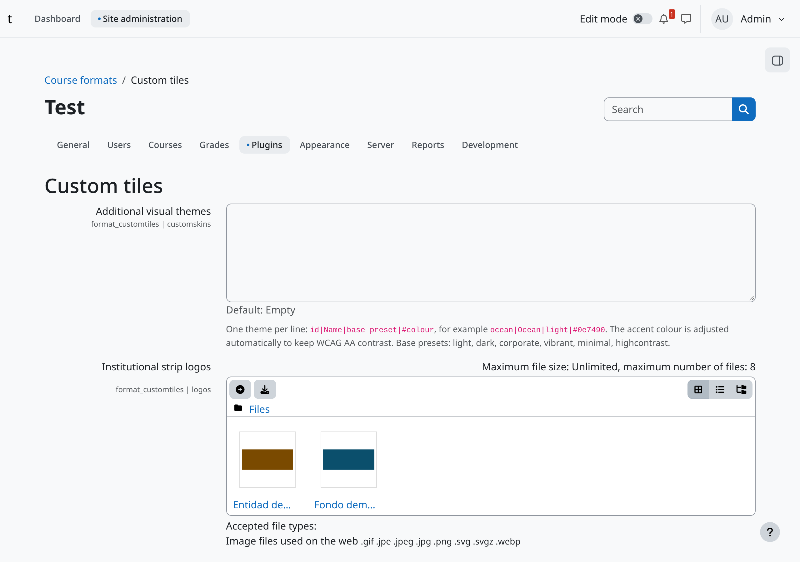
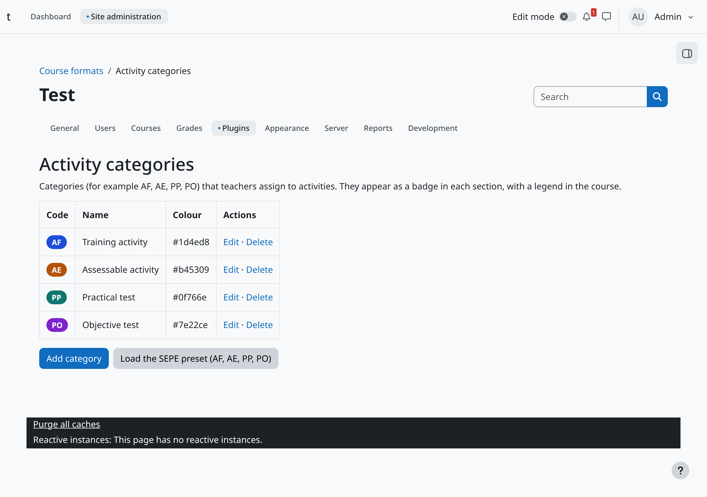

# Administrator guide — Custom tiles

*[Versión en español](guia_admin.md)*

## 1. Requirements and installation

- Moodle 5.3 (`MOODLE_503_STABLE`). PHP 8.3 or 8.4, PostgreSQL 17+, MariaDB 11.4+ or MySQL 8.4+.
- The PHP GD extension (covers). When GD can write WebP, lighter WebP copies of the covers are created too.

Installation:

1. Download the release zip and upload it in **Site administration → Plugins → Install plugins**, or unzip it in
   `public/course/format/customtiles` (since Moodle 5.1 the web root is `public/`).
2. Complete the upgrade from **Site administration → Notifications** or with `php admin/cli/upgrade.php`.
3. To upgrade to a new version, replace the folder and repeat step 2. Follow-up work (such as converting older
   covers to WebP) runs by itself through cron.

## 2. Site settings

**Site administration → Plugins → Course formats → Custom tiles.**

| Setting | Description |
|---|---|
| **Additional visual themes** | One theme per line: `id\|Name\|base preset\|#colour`, for example `ocean\|Ocean\|light\|#0e7490`. The accent colour is adjusted automatically to WCAG AA contrast. Base presets: `light`, `dark`, `corporate`, `vibrant`, `minimal`, `highcontrast`. A malformed line is rejected with its line number. |
| **Institutional strip logos** | Up to 8 images (funding bodies, etc.). The alternative text is the file name without its extension: name them, for example, `European Social Fund Plus.png`. **The plugin ships no official logos**: use the files and the usage rules given by each body. Logos are public (served without logging in). |
| **Linear navigation** | Core setting for the previous/next links between activities. |

To make this the default format of new courses: **Site administration → Courses → Course default settings → Format**.

## 3. Activity categories

**Site administration → Plugins → Course formats → Activity categories.**

- Each category has a **code** (up to 20 letters, digits, hyphens or underscores, in capitals; for example `AF`), a **name**, a **colour** and an **icon**.
- **Load the SEPE preset** creates AF (training activity), AE (assessable activity), PP (practical test) and PO
  (objective test). They can be edited or deleted afterwards.
- Deleting a category also removes its assignments (after a confirmation page).
- Teachers assign them in each course from **More → Activity categories**.
- Other plugins (a tracking report, for example) can read the assignments through the public API
  `\format_customtiles\api`.
- Backups carry assignments by **code**: when restored on another site they are linked to the category with the
  same code, if there is one.

## 4. Permissions

| Capability | Default | Use |
|---|---|---|
| `format/customtiles:managecategories` | Manager | Create, edit and delete site categories. |
| `format/customtiles:assigncategories` | Editing teacher and manager | Assign categories to the activities of a course. |

Section appearance (design view) uses the core permission to edit the course (`moodle/course:update`).

## 5. Dark mode

Moodle 5.3 has an experimental dark mode in Boost (**Appearance → Boost → Experimental**). When it is on, courses
with the "Light" visual theme (the default) are shown in "Dark" to whoever chooses dark mode. Other course themes are
kept. "Automatic" depends on the device, which the server does not know, so the course is then shown light.

## 6. Moodle app

The format supports the official app (checked with the app 5.3, see [app_movil.md](app_movil.md), in
Spanish). It needs **Site administration → Mobile app → Mobile settings → Enable web services for mobile devices**.
There are no settings of its own.

## 7. Privacy

The format stores user preferences only: the last activity visited in each course (for "Continue"), the date of
the previous visit (for the "New" state), and whether a teacher prefers the design view. They are exported and
deleted through Moodle's Privacy API, removed with the course, and removed when the plugin is uninstalled.

## 8. Performance

- Each student's progress is cached (MUC) and invalidated when a completion changes.
- Painting a course page costs a fixed number of queries, whatever the size of the course.
- Covers are re-encoded on upload (at most 1920 px) with 480 and 960 px versions and, when possible, WebP.

Details and measurements (in Spanish): [rendimiento.md](rendimiento.md). Security: [`SECURITY.md`](../SECURITY.md)
and the [threat model](modelo_amenazas.md).

## 9. Uninstalling

**Plugins → Plugins overview → Custom tiles → Uninstall.** Change the format of the courses that use it first. The
category tables, the preferences and the section covers are deleted.
