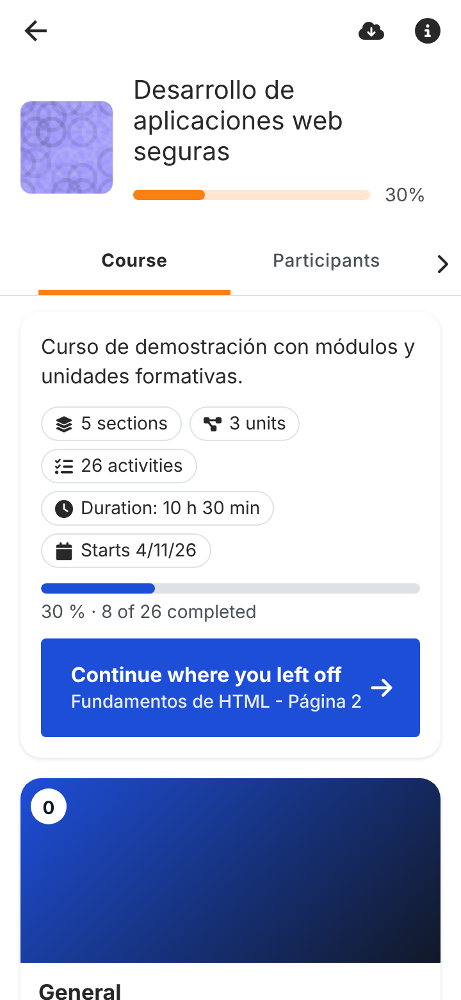
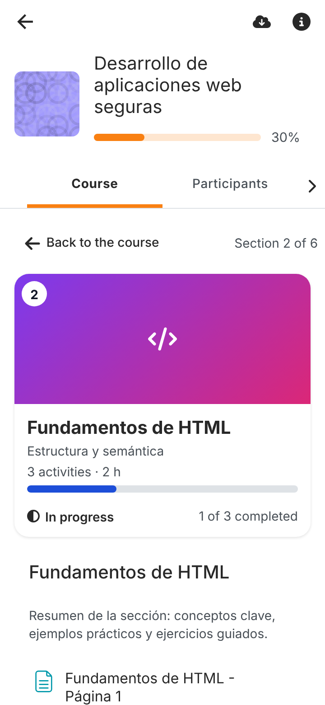
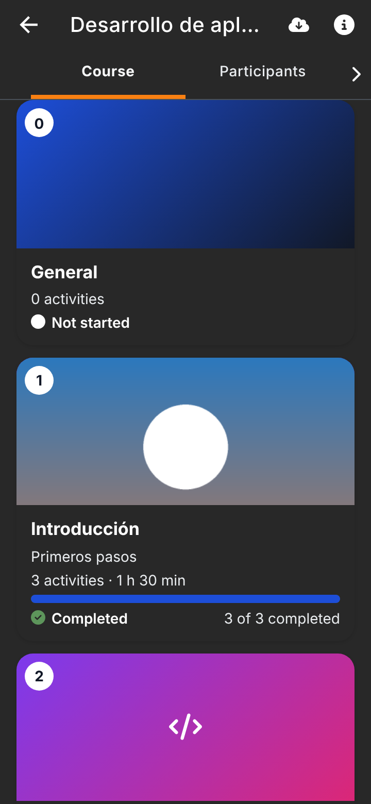
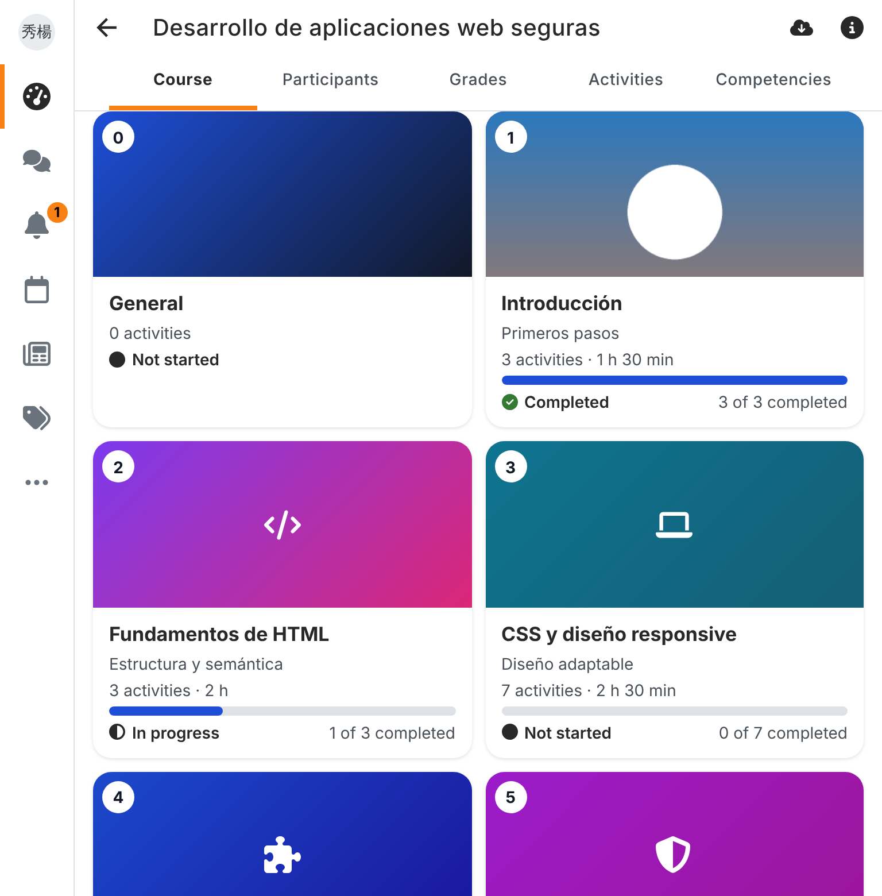

# App móvil oficial de Moodle (fase 6)

> **Estado: verificado en la app oficial 5.3.0** (versión web de `moodlehq/moodleapp`, ejecutada en el navegador
> contra un Moodle 5.3 local), a 360 px y 768 px y con la app en claro y en oscuro. Sin probar todavía: un
> dispositivo físico (Android/iOS) y el modo sin conexión. Resultados en la sección 4.

| Móvil | Sección | Oscuro | Tableta |
|---|---|---|---|
|  |  |  |  |

## 1. Qué hace

Sin este soporte, la app muestra los cursos de un formato desconocido con su formato por defecto. Con él:

- **Portada del curso**: resumen, píldoras (secciones, unidades, actividades, duración, fechas), barra de
  progreso global y botón **«Continuar donde lo dejaste»**, que abre la actividad con la navegación de la app.
- **Rejilla de secciones** (una columna en móvil, dos en tableta, tres en horizontal) con portada o color,
  icono, número, actividades, tiempo, unidades, progreso y **estado con icono y texto**. Las bloqueadas muestran
  el motivo y no se abren.
- **Vista de sección**: «Volver al curso», «Sección 2 de 6», cabecera con progreso y estado, el contenido de la
  sección con el componente de la propia app (`<core-course-section>`: actividades, finalización, descargas y
  unidades/subsecciones funcionan como en cualquier curso) y botones anterior/siguiente que saltan las bloqueadas.
- **Tema**: superficies y texto siguen el tema claro u oscuro de la app; el tema del curso aporta el color de
  acento (con su color de texto comprobado).
- **«Continuar» también aprende de la app**: un observador de `\core\event\course_module_viewed` guarda la última
  actividad vista aunque se abra desde la app o un servicio web, que no cargan la página web de la actividad.

## 2. Cómo está hecho

| Pieza | Función |
|---|---|
| `db/mobile.php` | Declara el formato en `CoreCourseFormatDelegate`, con método y hoja de estilos. Desactiva el índice de la app (la rejilla hace de índice). |
| `classes/output/mobile.php` | `mobile_course_view()`: comprueba el acceso, reúne los datos con las mismas clases que la web (`course_data`, `hero`, `section_style`) y renderiza la plantilla. |
| `templates/mobileapp/course.mustache` | Plantilla Angular/Ionic. moodle-plugin-ci excluye esa carpeta del lint HTML (la sintaxis de Ionic no es HTML de navegador); se renderiza con un escapado propio para Angular. |
| `mobile.css` | Estilos de la app (CSS a mano, variables de Ionic). |

La sección abierta se guarda en `CONTENT_OTHERDATA.section`; todo el texto llega preparado desde PHP, así que
las únicas expresiones de Angular son las previstas: abrir y cerrar secciones, la lista `sections` de la app y
`CoreCourseHelperProvider.navigateToModule()`.

## 3. Seguridad: texto de usuario en una plantilla Angular

La app compila la respuesta como plantilla Angular, donde `{{ … }}` es código. Un docente que pusiera
`{{constructor.constructor('…')()}}` en el nombre de una sección podría ejecutar código en la app de cada alumno.

Durante el desarrollo se comprobó con el compilador oficial de Angular (la misma versión 20.3 que usa la app 5.3)
que **escapar las llaves como entidades HTML (`&#123;`) no protege**: Angular decodifica las entidades antes de
buscar expresiones. El escapado final (`mobile::escape()`) sustituye cada llave por la expresión constante que
documenta Angular (`{{ '{' }}`). Con nombres, subtítulos y resúmenes hostiles, el análisis de la plantilla no
encuentra ninguna expresión que no sea esa constante, y una llave suelta tampoco rompe la plantilla.
`tests/mobile_test.php` fija este comportamiento.

## 4. Verificación

Hecha el 22-11-2026 con la app 5.3.0 (código de `moodlehq/moodleapp`, `ionic serve` con Node 24) en Chromium a
360×780 y 768×780, como alumno, contra el Moodle 5.3 local con los servicios web para móviles activados. Script
de Playwright que recorre la app y comprueba cada paso:

| Comprobación | Resultado |
|---|---|
| El sitio anuncia el plugin y la app usa el formato (no el predeterminado) | Sí |
| Portada: resumen, píldoras, progreso «30 % · 8 de 26» y «Continuar» | Sí |
| «Continuar» abre la actividad en la app | Sí |
| Rejilla: 7 secciones con portada, color, icono, progreso y estado (sin empezar, en curso, completada, bloqueada) | Sí |
| Una columna a 360 px, dos a 768 px; sin scroll horizontal; botones de al menos 44 px | Sí |
| Abrir una sección (también desde el final de la rejilla): empieza en su cabecera, «Sección 2 de 6» como en la web | Sí (corregido durante la prueba: contaba la sección General y se quedaba a media altura) |
| Actividades de la sección con el componente de la app («Hecho» / «Marcar como hecho») | Sí |
| Siguiente / Anterior y «Volver al curso» | Sí |
| Abrir una actividad y volver: la sección sigue abierta | Sí |
| Tras ver una actividad en la app, «Continuar» apunta a la siguiente pendiente | Sí (observador de `course_module_viewed`) |
| Tema oscuro de la app (`html.dark`): superficies y texto oscuros, acento del curso | Sí |
| Errores de consola propios | Ninguno. Aparece `onAriaChanged` de la propia app, también en su pantalla de conexión, antes de cargar el curso |

Para repetirla en un dispositivo: **Administración del sitio → Móvil → Configuración móvil → Activar servicios web
para dispositivos móviles**, entrar con la app oficial como alumno en un curso con este formato y repasar la tabla.

## 5. Límites conocidos

- Solo el layout de rejilla (el plan pide como mínimo Tiles). Los demás layouts del curso se muestran como
  rejilla en la app.
- Sin mapa del curso ni leyenda de categorías en la app.
- El modo «sin conexión» depende de lo que la app guarde de `tool_mobile_get_content`; no se ha probado.
