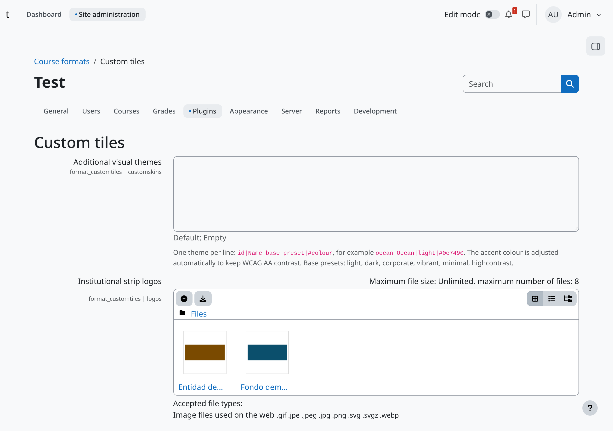
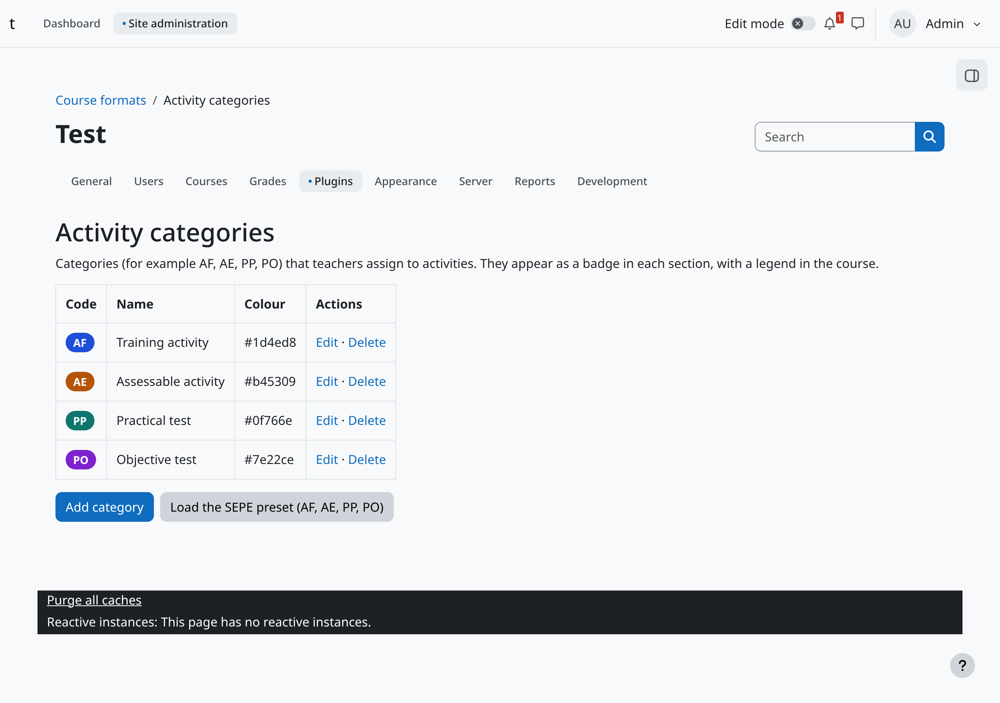

# Guía para administradores — Custom tiles

*[English version](admin_guide.md)*

## 1. Requisitos e instalación

- Moodle 5.3 (`MOODLE_503_STABLE`). PHP 8.3 u 8.4, PostgreSQL 17+, MariaDB 11.4+ o MySQL 8.4+.
- Extensión GD de PHP (portadas). Si GD puede escribir WebP, el formato crea además copias WebP más ligeras.

Instalación:

1. Descarga el zip de la versión y súbelo en **Administración del sitio → Extensiones → Instalar extensiones**, o
   descomprímelo en `public/course/format/customtiles` (desde Moodle 5.1 el directorio web es `public/`).
2. Completa la actualización desde **Administración del sitio → Notificaciones** o con
   `php admin/cli/upgrade.php`.
3. Para actualizar a una versión nueva, sustituye la carpeta y repite el paso 2. Las tareas posteriores (por
   ejemplo, convertir portadas antiguas a WebP) se ejecutan solas con el cron.

## 2. Ajustes del sitio

**Administración del sitio → Extensiones → Formatos de curso → Custom tiles.**

| Ajuste | Descripción |
|---|---|
| **Temas visuales adicionales** | Un tema por línea: `id\|Nombre\|preset base\|#color`, por ejemplo `oceano\|Océano\|light\|#0e7490`. El color de acento se ajusta automáticamente al contraste WCAG AA. Presets base: `light`, `dark`, `corporate`, `vibrant`, `minimal`, `highcontrast`. Una línea mal escrita se rechaza con el número de línea. |
| **Logotipos de la franja institucional** | Hasta 8 imágenes (entidades financiadoras, etc.). El texto alternativo es el nombre del archivo sin extensión: llámalos, por ejemplo, `Fondo Social Europeo Plus.png`. **El plugin no incluye logotipos oficiales**: usa los archivos y las normas de uso que te facilite cada organismo. Los logotipos son públicos (se sirven sin iniciar sesión). |
| **Navegación lineal** | Ajuste del core para los enlaces anterior/siguiente entre actividades. |

Para que este formato sea el predeterminado de los cursos nuevos: **Administración del sitio → Cursos →
Valores por defecto del curso → Formato**.

## 3. Categorías de actividad

**Administración del sitio → Extensiones → Formatos de curso → Categorías de actividad.**

- Cada categoría tiene **código** (hasta 20 letras, dígitos, guiones o guiones bajos, en mayúsculas; por ejemplo `AF`), **nombre**, **color** e **icono**.
- **Cargar el preset SEPE** crea AF (actividad formativa), AE (actividad evaluable), PP (prueba práctica) y PO
  (prueba objetiva). Después se pueden editar o borrar libremente.
- Borrar una categoría quita también sus asignaciones (con página de confirmación).
- El profesorado las asigna en cada curso desde **Más → Categorías de actividad**.
- Otros plugins (por ejemplo, un informe de seguimiento) pueden leer las asignaciones con la API pública
  `\format_customtiles\api`.
- En las copias de seguridad las asignaciones viajan por **código**: al restaurar en otro sitio se enlazan con la
  categoría del mismo código si existe.

## 4. Permisos

| Capacidad | Por defecto | Uso |
|---|---|---|
| `format/customtiles:managecategories` | Gestor | Crear, editar y borrar categorías del sitio. |
| `format/customtiles:assigncategories` | Profesor (editor) y gestor | Asignar categorías a las actividades de un curso. |

El aspecto de las secciones (vista de diseño) usa los permisos del core para editar secciones
(`moodle/course:update`).

## 5. Modo oscuro

Moodle 5.3 incluye un modo oscuro experimental en Boost (**Apariencia → Boost → Experimental**). Si lo activas,
los cursos con el tema visual «Claro» (el predeterminado) se ven en «Oscuro» para quien elija el modo oscuro. Los
demás temas del curso se respetan. El modo «automático» depende del dispositivo y el servidor no lo conoce, así
que en ese caso el curso se ve en claro.

## 6. App de Moodle

El formato tiene soporte para la app oficial (probado con la app 5.3, ver [app_movil.md](app_movil.md)).
Requiere **Administración del sitio → Móvil → Configuración móvil → Activar servicios web para dispositivos
móviles**. No hay ajustes propios.

## 7. Privacidad

El formato guarda dos preferencias por usuario y curso: la última actividad visitada (para «Continuar») y la fecha
de la visita anterior (para el estado «Nueva»), además de si el docente prefiere la vista de diseño. Todas se
exportan y borran con la API de privacidad de Moodle y se eliminan al borrar el curso.

## 8. Rendimiento

- El progreso de cada alumno se guarda en caché (MUC) y se invalida cuando cambia una finalización.
- Pintar la portada de un curso cuesta un número fijo de consultas, sea cual sea su tamaño.
- Las portadas se recodifican al subirlas (máximo 1920 px) con versiones de 480 y 960 px y, si es posible, WebP.

Detalle y mediciones: [rendimiento.md](rendimiento.md). Seguridad: [`SECURITY.md`](../SECURITY.md) y
[modelo de amenazas](modelo_amenazas.md).

## 9. Desinstalación

**Extensiones → Vista general de extensiones → Custom tiles → Desinstalar.** Antes, cambia el formato de los
cursos que lo usen. Se borran las tablas de categorías, las preferencias y las portadas de las secciones.
