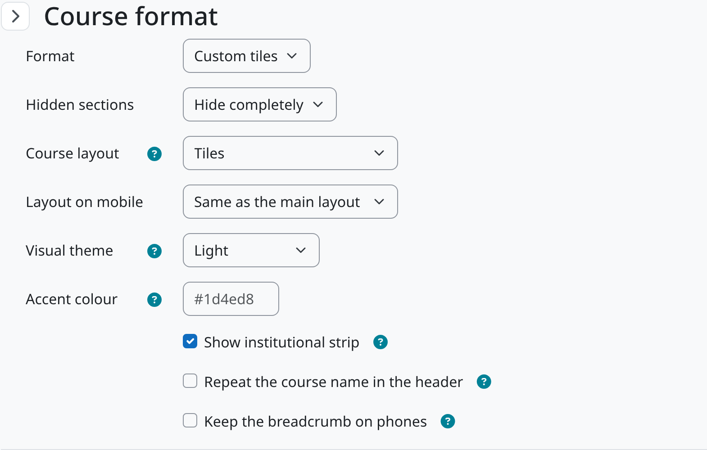
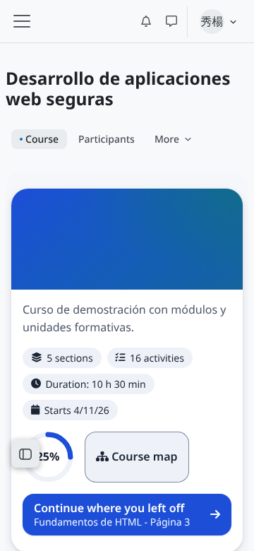
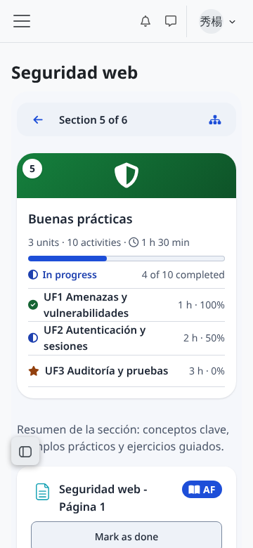
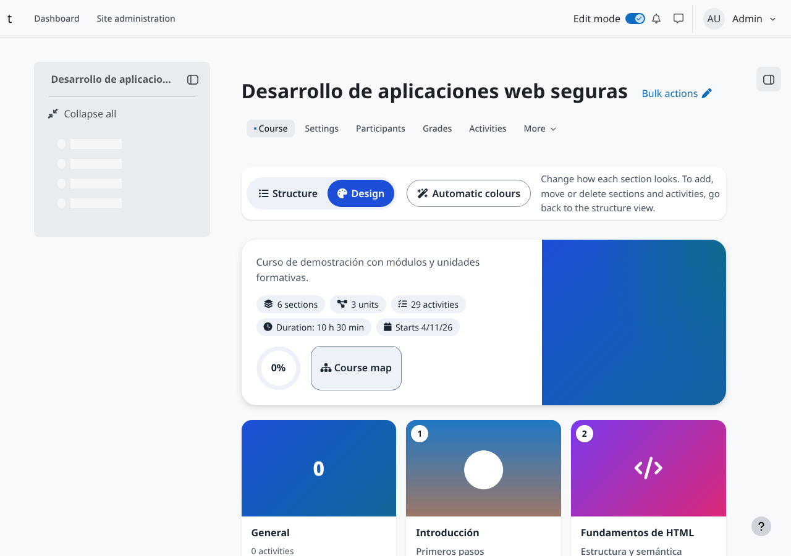
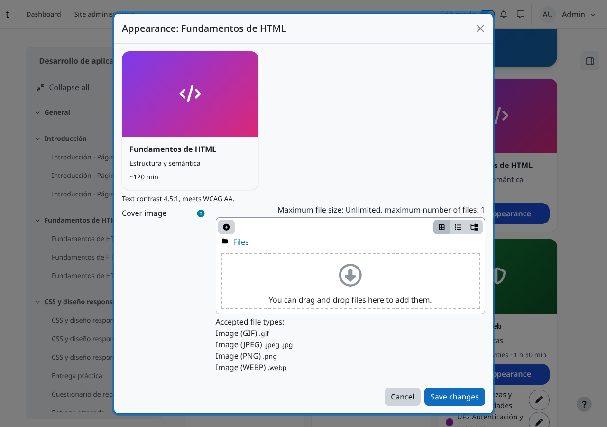
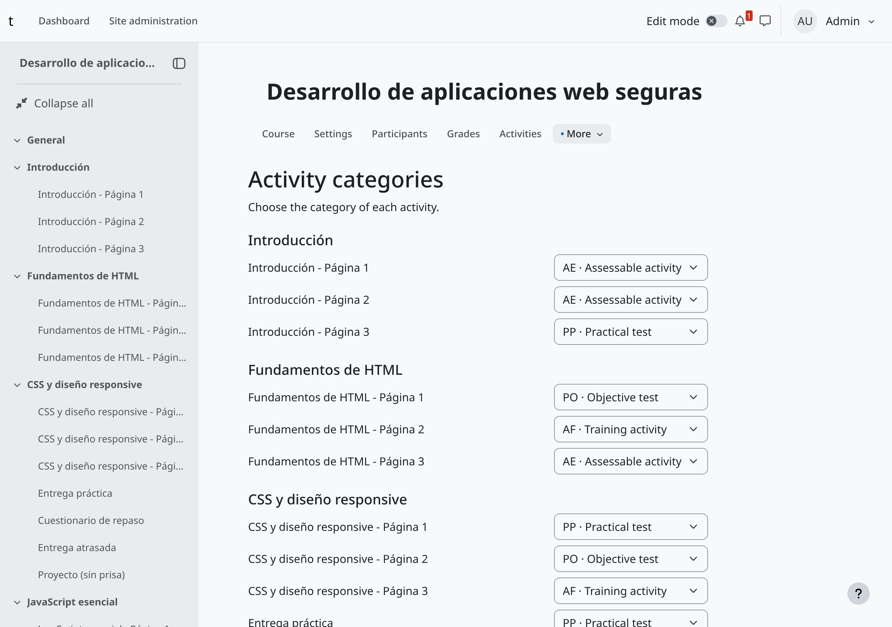

# Guía para docentes — Custom tiles

*[English version](teacher_guide.md)*

Custom tiles es un formato de curso para Moodle 5.3 que muestra las secciones como un panel visual, pensado
primero para el móvil, y que cumple de serie los requisitos de usabilidad y accesibilidad de la teleformación
para el empleo (SEPE/SCE, Orden TMS/369/2019, Anexo IV).

## 1. Activarlo en un curso

**Ajustes del curso → Formato de curso → Formato: Custom tiles.**

| Ajuste | Para qué sirve |
|---|---|
| **Diseño del curso** | Cómo se muestran las secciones: Tiles (mosaico), Tarjetas grandes, Itinerario, Carrusel, Bento o Lista compacta. |
| **Diseño en móvil** | Otro diseño solo para pantallas pequeñas (por ejemplo, Tarjetas en ordenador y Carrusel en móvil). |
| **Tema visual** | Claro, Oscuro, Corporativo, Vibrante, Minimal, Alto contraste o los que añada la administración. Todos cumplen el contraste WCAG AA. Si el sitio tiene activado el modo oscuro y el alumno lo elige, «Claro» se ve como «Oscuro». |
| **Color de acento** | Opcional. El formato genera a partir de él una paleta legible; si el color no tiene contraste suficiente, lo ajusta. |
| **Mostrar franja institucional** | Logotipos (entidades financiadoras…) que sube la administración, al pie del curso. |
| **Repetir el nombre del curso en la cabecera** | Solo si tu tema no muestra ya el nombre del curso como título. |
| **Mantener la miga de pan en móviles** | En móvil, la barra de contexto sustituye a la miga de pan. No afecta a los registros ni al seguimiento. |
| **Secciones ocultas** | Igual que en el resto de formatos de Moodle. |

Para que se vean el progreso, los estados y el botón «Continuar», activa el **rastreo de finalización** del curso
y configura la finalización de las actividades.

## 2. Qué ve el alumnado

- **Cabecera del curso**: portada, descripción, píldoras con duración, número de secciones, unidades y actividades
  y fechas, anillo de progreso y botón **«Continuar donde lo dejaste»**, que lleva a la última actividad visitada
  o a la siguiente pendiente (Anexo IV: reanudar en el punto donde se dejó).
- **Secciones** con portada, número, progreso y **estado** con icono y texto (nunca solo color): sin empezar,
  en curso, completada, bloqueada (con el motivo de la restricción), oculta y **nueva** (añadida desde la visita
  anterior del alumno).
- **Página de sección**: cabecera de la sección, barra «Sección 2 de 6» con vuelta atrás y mapa, actividades y
  navegación anterior/siguiente (también deslizando el dedo).
- **Mapa del curso**: estructura completa con el estado de cada sección y actividad, a un toque desde la cabecera
  y desde la barra de contexto. Se imprime bien.
- **Avisos de plazo** en las actividades con fecha: «Vence hoy», «Vence en 3 días», «Fuera de plazo».

## 3. Módulos y unidades formativas

Para una estructura **módulo → UF**, usa una sección por módulo y, dentro de ella, una **subsección** por unidad
(en modo edición: «Añadir contenido → Subsección»). El formato la trata como unidad: numeración «2.1», «2.2», su
propio progreso y estado, «Unidad 1 de 3» en la barra de contexto, y el progreso del módulo suma el de sus
unidades (Anexo IV: barra de progreso por módulo/UF).

## 4. Dar aspecto a las secciones (vista de diseño)

Con el **modo edición** activado aparece encima del curso el conmutador **Estructura / Diseño**:

- **Estructura**: la lista de siempre de Moodle para añadir, mover y borrar secciones y actividades.
- **Diseño**: un tile por sección y unidad con el botón **«Editar aspecto»**.

En «Editar aspecto» puedes cambiar, con vista previa en vivo:

- **Imagen de portada** (PNG, JPEG, GIF o WebP, hasta 5 MB). Se recodifica y se generan tamaños para móvil y
  ordenador; no hace falta optimizarla. Usa imágenes apaisadas.
- **Punto focal**: haz clic en la parte de la imagen que siempre debe verse (o usa las flechas del teclado).
- **Icono**, **color** y **segundo color** (degradado). El modal muestra el contraste del texto sobre esos colores
  y avisa si no llega a AA.
- **Subtítulo** y **tiempo estimado** (minutos). El tiempo de todo el curso se suma en la cabecera.
- **Aplicar también colores e icono a** otras secciones o unidades.

**Colores automáticos** (botón de la barra de diseño): da a cada sección un color distinto a partir de un color
base, todos legibles con texto blanco. Puedes aplicarlo solo a las secciones sin color o a todas.

Los mismos campos están también en el formulario clásico de edición de cada sección.

## 5. Categorías de actividad (AF, AE, PP, PO…)

Si la administración ha creado categorías (por ejemplo, el preset SEPE: Actividad formativa, Actividad
evaluable, Prueba práctica, Prueba objetiva), asígnalas en **Más → Categorías de actividad**. Cada actividad
muestra su insignia (código, icono y nombre accesible) y el curso incluye una leyenda.

## 6. App de Moodle

En la app oficial el curso se muestra con la portada, «Continuar», la rejilla de secciones con su progreso y
estado, y cada sección con las actividades de la propia app (completar, descargar, unidades). El aspecto (portada,
color, icono) es el mismo; el diseño es siempre la rejilla y los colores de fondo siguen el tema claro u oscuro de
la app. *Pendiente de verificar en la app: ver [app_movil.md](app_movil.md).*

## 7. Copias de seguridad y plantillas

Las copias de seguridad y la importación conservan todos los ajustes del formato, el aspecto de las secciones
(portadas incluidas) y las categorías asignadas (por su código). Así puedes preparar un curso modelo y reutilizarlo.

## 8. Buenas prácticas de accesibilidad

- No pongas texto importante dentro de las imágenes de portada: son decorativas y no se leen en voz alta.
- Usa nombres de sección cortos y descriptivos; el subtítulo es para el detalle.
- Indica el tiempo estimado: ayuda al alumnado a planificar y aparece en la cabecera del curso.
- Revisa el curso en el móvil: es donde lo usará buena parte del alumnado.
