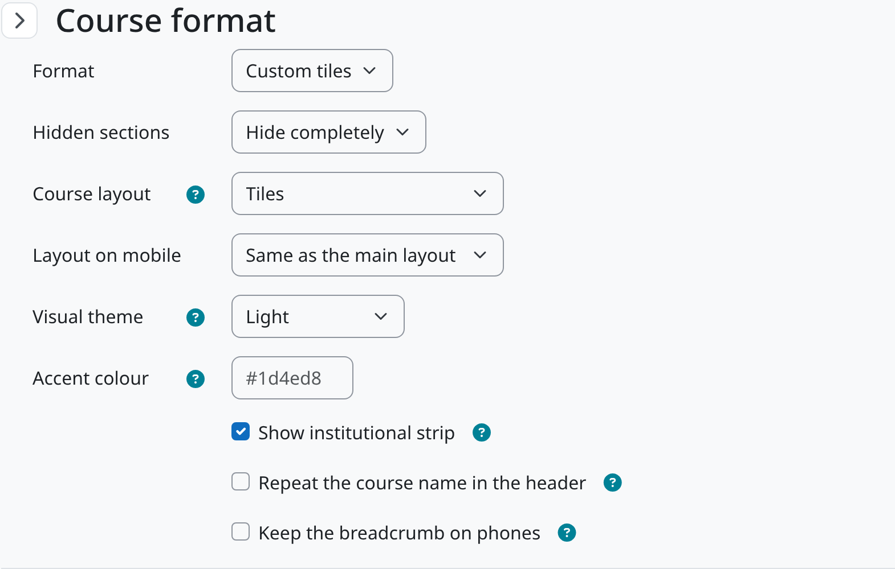
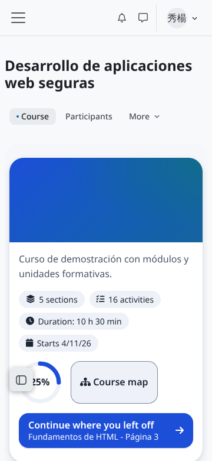
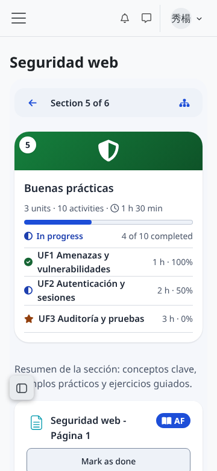
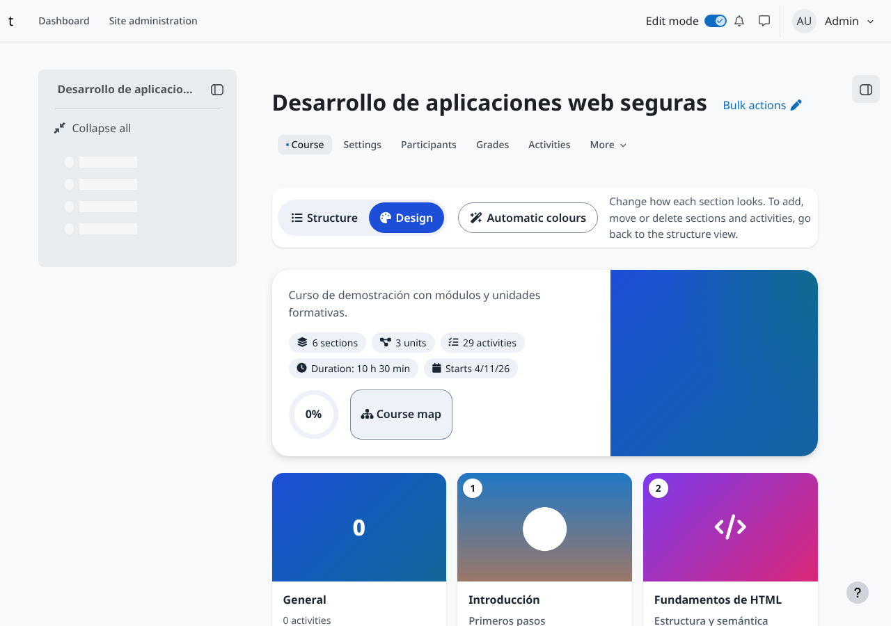
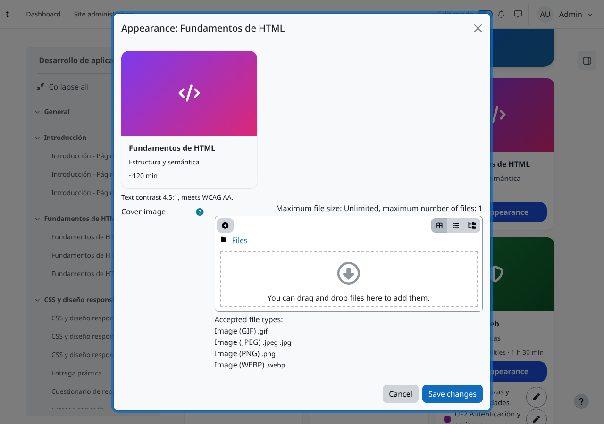
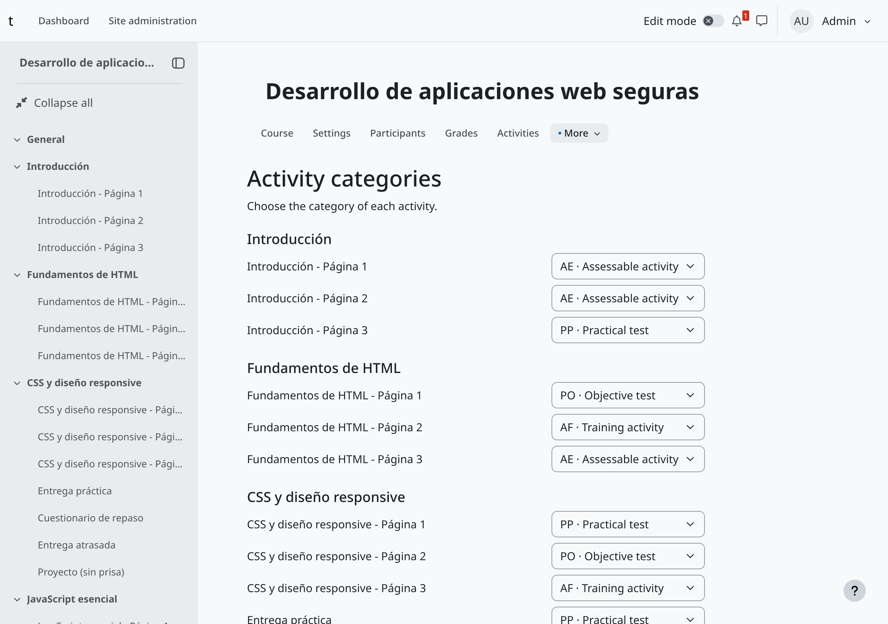

# Teacher guide — Custom tiles

*[Versión en español](guia_docente.md)*

Custom tiles is a course format for Moodle 5.3 that shows sections as a visual, mobile-first dashboard and meets
the usability and accessibility requirements of Spanish public employment e-learning (SEPE/SCE, Orden
TMS/369/2019, Annex IV) out of the box.

## 1. Turning it on for a course

**Course settings → Course format → Format: Custom tiles.**

| Setting | What it does |
|---|---|
| **Course layout** | How sections are shown: Tiles, Large cards, Path, Carousel, Bento or Compact list. |
| **Layout on mobile** | A different layout for small screens only (for example cards on a computer, carousel on a phone). |
| **Visual theme** | Light, Dark, Corporate, Vibrant, Minimal, High contrast, or those added by the administrator. All meet WCAG AA contrast. When the site has dark mode enabled and the student chooses it, "Light" is shown as "Dark". |
| **Accent colour** | Optional. A readable palette is generated from it; a colour without enough contrast is adjusted. |
| **Show institutional strip** | Logos (funding bodies…) uploaded by the administrator, at the foot of the course. |
| **Repeat the course name in the header** | Only if your theme does not already show the course name as the page title. |
| **Keep the breadcrumb on phones** | On phones the context bar replaces the breadcrumb. Logs and tracking are not affected. |
| **Hidden sections** | As in every other Moodle format. |

Progress, states and the "Continue" button need **completion tracking** enabled in the course and completion
conditions on the activities.

## 2. What students see

- **Course header**: cover, description, pills with duration, number of sections, units and activities and dates,
  a progress ring and **"Continue where you left off"**, which opens the last activity visited or the next one to do.
- **Sections** with cover, number, progress and a **state** with icon and text (never colour alone): not started,
  in progress, completed, locked (with the reason of the restriction), hidden and **new** (added since the
  student's previous visit).
- **Section page**: section header, a "Section 2 of 6" bar with a back link and the map, the activities, and
  previous/next navigation (also by swiping).
- **Course map**: the whole structure with the state of every section and activity, one tap away from the header
  and the context bar. It prints well.
- **Deadline notices** on dated activities: "Due today", "Due in 3 days", "Overdue".

## 3. Modules and units

For a **module → unit** structure, use one section per module and, inside it, one **subsection** per unit (in edit
mode: "Add content → Subsection"). The format treats it as a unit: numbered "2.1", "2.2", with its own progress
and state, "Unit 1 of 3" in the context bar; the module's progress adds up its units.

## 4. Styling sections (design view)

With **edit mode** on, a **Structure / Design** switch appears above the course:

- **Structure**: Moodle's usual list to add, move and delete sections and activities.
- **Design**: one tile per section and unit with an **"Edit appearance"** button.

"Edit appearance" changes, with a live preview:

- **Cover image** (PNG, JPEG, GIF or WebP, up to 5 MB). It is re-encoded and resized for phones and computers;
  no need to optimise it. Use landscape images.
- **Focal point**: click the part of the image that must always be visible (or use the arrow keys).
- **Icon**, **colour** and **second colour** (gradient). The modal shows the text contrast on those colours and
  warns when it is below AA.
- **Subtitle** and **estimated time** (minutes). The time of the whole course is added up in the header.
- **Also apply colours and icon to** other sections or units.

**Automatic colours** (design bar button) give every section a different colour from a base colour, all readable
with white text, for sections without a colour or for all of them.

The same fields are also on the classic edit form of each section.

## 5. Activity categories (AF, AE, PP, PO…)

When the administrator has created categories (for example the SEPE preset: training activity, assessable
activity, practical test, objective test), assign them in **More → Activity categories**. Each activity shows its
badge (code, icon and accessible name) and the course shows a legend.

## 6. Moodle app

In the official app the course shows its header, "Continue", the grid of sections with progress and state, and
each section with the app's own activity list (completion, downloads, units). Covers, colours and icons are the
same; the layout is always the grid, and backgrounds follow the app's light or dark theme. *Pending verification in
the app: see [app_movil.md](app_movil.md) (in Spanish).*

## 7. Backups and templates

Backups and imports keep every format setting, the appearance of the sections (covers included) and the assigned
categories (by code), so a model course can be prepared once and reused.

## 8. Accessibility tips

- Do not put important text inside cover images: they are decorative and are not read aloud.
- Keep section names short and descriptive; the subtitle is for detail.
- Give an estimated time: it helps students plan and shows in the course header.
- Check the course on a phone: that is where many students will use it.
